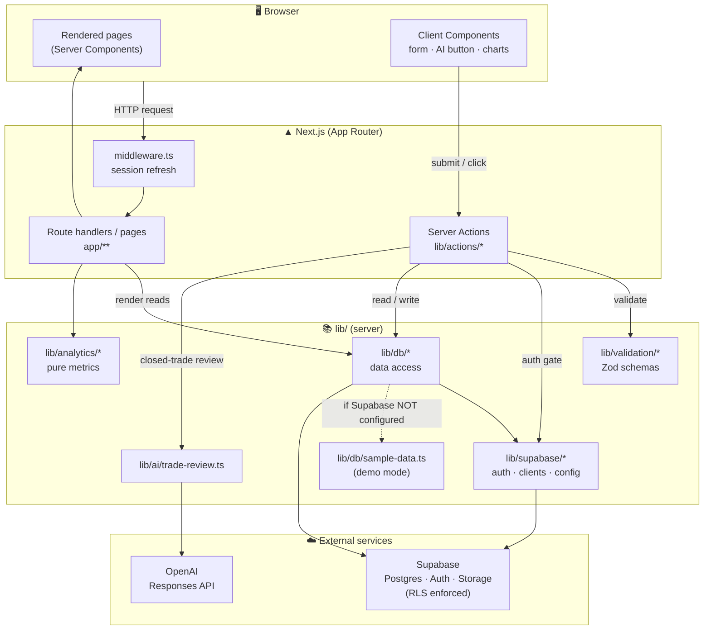

# Architecture

## Overview

Noemo is a Next.js **App Router** application. Almost everything runs on the
server: pages are React Server Components that read data directly from the data
layer, and mutations go through **Server Actions**. A handful of interactive
pieces (forms, the AI review button, charts) are Client Components.

## Top-level architecture diagram



Text fallback:

```
Browser
  │
  ├── RSC page render ──► lib/db/* ──► Supabase (or sample-data in demo mode)
  │
  └── form submit / button ──► Server Action (lib/actions/*) ──► lib/db/* ──► Supabase
                                          │
                                          └── lib/ai/trade-review.ts ──► OpenAI Responses API
```

## Directory layout

```
app/                      App Router routes
  layout.tsx              Root layout (fonts, global CSS, metadata)
  globals.css             Global styles, dark theme base, scrollbars
  (marketing)/page.tsx    Public landing page
  (auth)/login/page.tsx   Login / sign-up
  app/                    Authenticated area (protected by app/app/layout.tsx)
    layout.tsx            requireUser() gate + AppShell
    page.tsx              Dashboard
    trades/page.tsx       Trades list + filters
    trades/new/page.tsx   Create trade
    trades/[id]/page.tsx  Trade detail + AI review
    trades/[id]/edit/     Edit trade

components/
  app/                    Feature components (dashboard, table, form, charts, AI button, shell)
  landing/                Marketing landing page
  ui/                     Reusable primitives (button, card, badge, field, empty-state, logo)

lib/
  actions/                Server Actions (auth, trades)
  ai/                     OpenAI post-trade review service
  analytics/              Pure metric calculations
  db/                     Data access (Supabase queries + demo fallback), types, sample data
  supabase/               Client/server/middleware Supabase helpers, auth, config
  validation/             Zod schemas for trade input
  utils.ts                Formatting + cn() helpers

supabase/migrations/      SQL migration (schema, RLS, storage, triggers)
tests/                    Vitest unit tests
middleware.ts             Session refresh on every request
```

## Routing & route groups

- `(marketing)` and `(auth)` are **route groups** — they organize files without
  adding URL segments. `/` → landing, `/login` → auth.
- `app/app/*` is the **authenticated area**. Its `layout.tsx` calls
  `requireUser()`, which redirects unauthenticated visitors to `/login`, and
  wraps children in `AppShell` (nav + chrome).
- Dynamic route `app/app/trades/[id]` renders trade detail; `[id]/edit` renders
  the edit form. Both `await params` (Next.js 15 async params).

## Rendering model

- **Server Components** (default): pages fetch data via `lib/db/*` and render
  HTML on the server. Examples: dashboard, trades list, trade detail.
- **Client Components** (`"use client"`): `trade-form.tsx` (react-hook-form),
  `ai-review-button.tsx` (pending state), `performance-charts.tsx` (Recharts),
  parts of the landing page.
- **Server Actions** (`"use server"` in `lib/actions/*`): all writes. They
  validate input, enforce demo-mode/auth, perform the mutation, then call
  `revalidatePath()` to refresh affected routes.
- **Caching:** read functions in `lib/db/trades.ts` call
  `unstable_noStore()` so journal data is always fresh per request.

## Data flow: logging a trade

1. User submits `TradeForm` (client) which posts a `FormData` to
   `createTradeAction`.
2. `createTradeAction` (`lib/actions/trades.ts`) runs on the server:
   - `requireUser()` → resolves the user / demo flag.
   - If `demoMode`, returns a read-only error.
   - `formDataToTradeInput(formData)` → Zod-validated `TradeInput`.
   - `createTradeRecord(user.id, input, screenshot)` inserts the trade, its
     behavior row, and any attachments (uploading a screenshot to Storage).
   - `revalidatePath("/app")` and `/app/trades`.
3. The list/dashboard re-render with the new trade.

## Authentication

- `lib/supabase/auth.ts`
  - `getCurrentUser()` → `{ user, demoMode }`. In demo mode returns a fixed
    `demoUser`; otherwise calls `supabase.auth.getUser()`.
  - `requireUser()` → same, but redirects to `/login` if there is no user.
- `lib/actions/auth.ts` → `signInAction`, `signUpAction`, `signOutAction`
  (Supabase email/password). In demo mode they just redirect.
- `middleware.ts` refreshes the Supabase session cookie on every matching
  request (skips static assets/images). It is a no-op when Supabase is not
  configured.
- Server-side row access is additionally protected by **Row Level Security** in
  Postgres (see [DATA_MODEL.md](./DATA_MODEL.md)).

## Supabase clients

| Helper | File | Use |
|--------|------|-----|
| Browser client | `lib/supabase/client.ts` | Client Components |
| Server client | `lib/supabase/server.ts` | Server Components / Actions (cookie-aware) |
| Middleware client | `middleware.ts` | Session refresh |
| Config | `lib/supabase/config.ts` | `isSupabaseConfigured()`, `getSupabaseConfig()` |

## Demo mode

Demo mode is the fallback when `isSupabaseConfigured()` is `false`:

- **Reads** (`listTrades`, `getTradeById`) return data from
  `lib/db/sample-data.ts` instead of querying Supabase.
- **Writes** (`createTradeRecord`, `updateTradeRecord`, `saveAiTradeReview`)
  throw / are short-circuited by the actions with a "read-only" message.
- **Auth** is bypassed; `getCurrentUser()` returns the fixed demo user, so the
  protected area is reachable.

This lets the entire UI (including the dark theme, charts, and sample AI review)
be explored with zero backend configuration.
